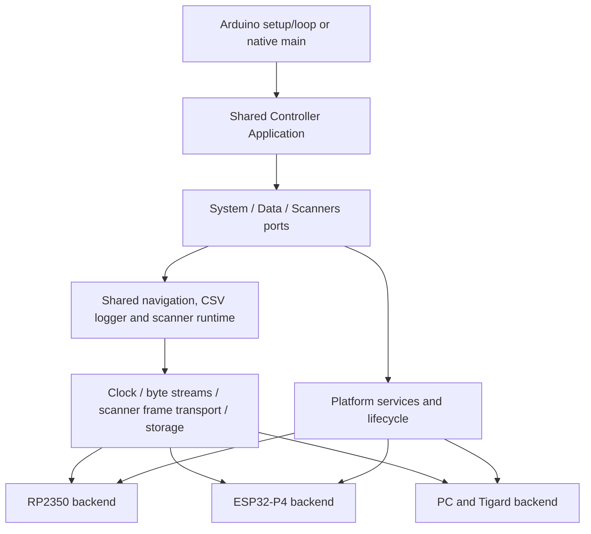

# Unified controller application

Development branch: `controller-hal`, based on `p4-controller` (`d7c5f12`), which
includes the RP2350 `main` baseline and P4 bring-up. The remote had no
`p4-testing` branch when this work started.

## One application, three backends

Both embedded environments compile the same `src/controller/main.cpp`, a thin
framework adapter calling `Application::begin()` and `Application::poll()`.
The separate P4 main and controller runtime have been removed. The native
`tigard-controller` executable runs the same application and runtime sources.
There are no target-selection macros or board-specific includes in application
policy, navigation policy or scanner orchestration.



| Shared application/runtime | Hardware backend |
| --- | --- |
| Startup sequencing and application poll | Pin/peripheral initialization and framework entry linkage |
| UART > USB > BLE fix priority and hardware parser fallback | GNSS UART configuration, USB CDC transport, BLE transport |
| Freshness/satellite qualification and BLE parser/session lifecycle | Nonblocking byte access and BLE callback queues |
| Fix-acquisition relogging and reset cooldown | SPI, CS/OE/latch sequencing and timing guarantees |
| Logger recovery, append, flush, reset records and bounded result draining | SdFat versus mounted SDMMC/POSIX file access and checked errors |
| Scanner protocol, firmware update protocol, scheduler, dedupe and bounded queues | Core/task/thread launch, update image access and watchdog implementation |
| Console mirroring, command parsing, status and diagnostic scheduling | Serial/USB byte transport, LED rendering, reset button and reboot |
| Storage diagnostic duration and scheduling | Scratch-file read/write/verify operation |
| Capability-aware diagnostics and injected policy | Availability of USB/BLE NMEA, MTP and firmware updating |

`include/controller/application.h` defines the application ports and policy. It
has no Arduino, RTOS, filesystem or board dependency. `src/controller/application.cpp`
contains the sole application loop. `src/controller/runtime.cpp` supplies shared
navigation, scanner and logger services. TinyGPS++ and the existing Print-based
logger use a small framework compatibility adapter on PC; application policy
compiles without that adapter.

Platform composition and hardware lifecycle live in:

- `src/rp2350/controller.cpp`
- `src/p4/controller.cpp`
- `pc/controller.cpp`

Board policy is injected at composition: RP2350 retains boot timestamp capture
and the valid-time gate; P4 retains `P4_REQUIRE_GNSS_TIME_FOR_LOGGING=0`. The
logger receives the time policy as configuration rather than inferring it from
the target. PC uses its existing host time initially and keeps subsequent GNSS
clock synchronization inside the process; it never sets the host system clock.

RP2350 MTP registration, descriptor setup, boot controller updating,
storage locking, status LED, reset button and heartbeat-gated watchdog remain
in its backend. P4 retains core-0 application/BLE affinity, core-1 scanner SPI,
the pinned SDK/exFAT replacement, SDMMC mount cleanup and pad drive strength.
Its task watchdog and BLE/SD hardware setup remain backend responsibilities.
Device IDs live in `src/arduino/logging.cpp` and `pc/logging.cpp`.
The shared logger depends on `include/hal/log_storage.h`: owned file handles with
checked append/write/size/flush/close operations and storage mount/recovery hooks.
Its configuration contains retry policy, not pins, bus frequencies or filesystem
types. It supplies UTC timestamp fields; filesystem-specific encoding stays in
the adapter.

`include/rp2350/log_storage.h` owns SdFat, SD chip select, SPI frequency fallback,
bounded recovery steps and FAT timestamp packing. MTP requests a flush through
the application while holding its existing storage lock. `src/p4/log_storage.h`
owns SDMMC mounting and uses the mounted VFS through the POSIX adapter.
`include/posix/log_storage.h` provides the native directory backend as well as
mounted-VFS file access, preserving append contents and checking short writes,
size queries, fsync and close errors. It does not depend on Arduino or an SDK. The library is `lib/controller_logging`, using the
neutral `controller::logging` namespace. Scan observations use
`controller::ScanResult` independently of the logger.

Sources are organized by responsibility:

```text
src/controller/  shared application, navigation, scanner runtime and scanner updater
src/rp2350/      RP2350 composition, controller bootloader and MTP storage
src/p4/          P4 composition, BLE, SDMMC and scanner SPI task adapter
src/arduino/     Arduino framework adapters and injected configuration
pc/             native composition, POSIX storage/UART and Tigard MPSSE
include/        matching controller/, rp2350/, arduino/ and hal/ interfaces
```

`src/controller/scanner_update.cpp` owns scanner firmware identification, hashing,
CRC, retries, acknowledgements, sector splitting and applied-file naming. All
three backends invoke it during the same application startup window, before the
normal scanner worker starts. Filesystem adapters and progress indication remain
platform services. A staged `/scanner.bin` is retained for retries unless every
identified update-capable scanner succeeds; successful completion renames it to
an unused applied filename without replacing an existing image.

On P4, image access and hashing remain on core 0. A temporary bounded request/
response adapter runs physical SPI operations on core 1, then shuts down before
the normal scanner task launches. Shutdown failure prevents a second SPI owner.
RP2350 and PC use their HAL transport directly during this exclusive boot window.
The controller's own RP2350 bootloader update remains platform-specific.

Inter-worker result/diagnostic queues are now shared fixed-capacity SPSC queues,
with 1,024 and 64 entries, acquire/release synchronization, and nonblocking
push/pop. Peripheral/parser/file ownership remains single-owner. Application
work stays bounded: 64 results, 16 diagnostics, two phone messages, 128 console
bytes, 512 UART NMEA bytes and 256 USB NMEA bytes per poll. Results remain queued
while storage or the required clock is unavailable. All platforms relog on
location acquisition using the shared cooldown/deferred scanner reset policy.

## Low-level contracts

`include/hal/controller.h` defines `Clock`, `ByteStream`, `ScannerTransport` and
capabilities. Scanner transfers are exactly one mode-0, MSB-first, full-duplex
64-byte frame with CS asserted throughout. Transport failure invalidates the
entire reply. Normal and OTA frequency requests are explicit. Backends own
minimum gaps/setup/hold and safe OE/latch transitions.

P4 retains 10 MHz scanning, 1 MHz shift-register updates, a 1 ms gap between all
frames, and 5 microsecond CS setup/hold. Its MISO pull-up uses the GPIO pad API,
not `pinMode` after SPI initialization. RP2350 timing remains unchanged.
Command-specific waits/retries remain shared. Platform watchdog servicing is
separate from application policy and preserves the different watchdog models.

## P4 console transports

`waveshare_p4_controller` keeps its UART programming-port console (`Serial0`).
`waveshare_p4_usb_controller` selects native TinyUSB OTG mode and routes the
application console through its CDC interface (`Serial`). Flash it through the
UART programming connector, then open the device on the separate native OTG
connection. Both use the same application, scanner core placement and BLE/SD
services. Native USB writes are nonblocking; startup never waits for a terminal.
The native variant also registers CDC1 for raw NMEA before USB enumeration.
It reads TinyUSB's bounded FIFO directly, avoiding the SDK's potentially blocking
per-byte receive queue. CDC0 retains all console text. CDC1 input feeds the shared
USB parser and system-clock synchronization, while UART NMEA is mirrored to CDC1
by default without requiring DTR. Both directions remain bounded/nonblocking;
the NMEA interface cannot trigger the 1200-baud reboot gesture. The UART-console
build does not expose this interface. See [P4 build and connection details](p4-controller.md).

## Time services

`include/hal/time.h` separates monotonic intervals from UTC wall time. The shared
logger receives both services explicitly and contains no direct Arduino timing,
system-clock calls or process-wide timezone changes. Gregorian conversion and
CSV formatting operate on 64-bit epoch seconds in UTC.

RP2350 and P4 read their platform system/RTC clock through `gettimeofday` and
synchronize it from fresh GNSS date/time through checked `settimeofday` calls.
A plausible existing system clock can supply timestamps immediately at startup;
logging does not require GNSS to be the source of that clock. UTC updates do not
change retry, scanner or watchdog intervals. Failed clock reads/updates are
reported without treating an invalid clock as usable.

Time-source priority is UART, USB and BLE when available, independently of the
source chosen for position fields. A valid, fresh GNSS date/time can synchronize
the clock without a location fix. Repeated polling of the same GNSS timestamp
does not repeatedly reset the clock. Stale, impossible and placeholder dates are
rejected; failed synchronization retries are bounded by a monotonic cooldown.

PC reads the host system clock initially. After GNSS synchronization it advances
a process-local UTC anchor using the native 64-bit steady clock, leaving the host
clock untouched and continuing through 32-bit timer rollover. Embedded monotonic
time uses the native RP2350/P4 timer; ordinary short scanner intervals retain
their existing 32-bit wrap-safe arithmetic.

## PC / Tigard

The PC backend supports a real application executable, not only a probe:

```sh
sudo apt-get install cmake g++ pkg-config libftdi1-dev libxxhash-dev
# Install TinyGPSPlus with a controller build, or set TINYGPS_INCLUDE_DIR.
cmake -S pc -B .pio/pc
cmake --build .pio/pc -j 4
ctest --test-dir .pio/pc --output-on-failure
.pio/pc/tigard-controller TGxxxxxxxx /dev/serial/by-id/<interface-A-device> /existing/log/directory
```

The log directory must already exist and may be any local directory writable by
the process; no card or mount-point convention is required. CSV and reset logs
are rooted there without changing the process working directory. Normal shared
CSV filename uniqueness and append/error behavior apply. Ctrl-C stops and joins the scanner thread before
flushing the application-owned log. `:status`, `:gps-debug [on|off]` and
`:storage-test` work through stdin (`:sd-test` remains an alias). A `scanner.bin` staged in the log directory is
processed by the shared scanner updater on startup. Desktop MTP, BLE, board LED
and controller bootloader updates are unavailable. GNSS UART opens at 115200; the PC backend does
not automatically reconfigure the receiver.

Tigard interface A remains the kernel UART device; interface B is claimed through
libftdi1/MPSSE using an explicit adapter serial number. The backend does not
modify EEPROM contents. Keep the interface-A serial driver bound.

Default wiring in **SPI/JTAG** mode:

| Connection | Tigard signal |
| --- | --- |
| Receiver RX / TX | UART TX / RX, interface A |
| Scanner SCK / shift-register clock | BD0, JTAG TCK |
| Scanner MOSI / shift-register SER | BD1, JTAG TDI |
| Scanner MISO | BD2, JTAG TDO |
| Shift-register latch | BD4, JTAG TRST, header pin 7 |
| Active-low shift-register OE | BD5, JTAG SRST, header pin 8 |
| Direct scanner CS (`--direct`) | BD3, SPI CS / JTAG TMS |

Q0–Q5 select six scanners by default. OE and scanner CS require external pull-ups
for high-impedance startup/disconnect. Use matching target logic voltage and a
common ground. SPI-header WP/EN pins are pull-ups, not latch/OE GPIOs; use the
JTAG header for BD4/BD5. See the [Tigard pinout](https://github.com/tigard-tools/tigard#pinouts).

One full-duplex MPSSE operation clocks each frame. GPIO read-backs are execution
barriers before timing delays; USB/OS scheduling can add latency. Frequencies
round down to an achievable FTDI rate. Failed/partial USB transfers invalidate
the complete response, disable outputs on a best-effort basis and require
reopening/reinitializing the link.

`tigard-probe SERIAL UART [--direct]` remains available for bounded ID/NOP and
three-second UART sampling without starting scans or changing GNSS settings.
Real Tigard/UART/SPI concurrency and physical signal timing still require
hardware qualification.

## Sweep timing diagnostics

`pio run -e xiao_rp2350_controller_profile` builds the XIAO controller with
`SCANNER_SWEEP_PROFILE=1`. Normal builds compile the counters and timing probes
out. No SPI frequencies, waits, retries, scheduling policy or queue behavior
change in the diagnostic build. It emits two `Sweep profile:` lines per completed
coverage cycle through the existing nonblocking diagnostic queue:

- `wall_us`: measured sweep interval; `spi_us`: time inside frame transfers,
  including CS/shift-register handling; `wait_us`: actual time spent in explicit
  protocol waits; `other_us`: remaining time, including processing and scheduling.
- Frame/service-pass counts, scan/status/result/NOP frame counts, mismatched
  response tags, exhausted status-command retries and BUSY status polls.

The measurements have their own small overhead. Compare several steady-state
sweeps after initial identification and fix-acquisition dedupe resets, with the
same scanners and scanner firmware. Preserve both profile lines and the normal
coverage-cycle line. A previously built pre-HAL image is useful as an A/B control;
host tests verify accounting but cannot establish physical sweep performance.

## Tests and CI

```sh
python3 test/run_regressions.py
python3 test/run_regressions.py --firmware
python3 test/run_regressions.py --host-only
```

The runner accepts `--pio /path/to/pio`. Required host tools include CMake,
C/C++ compilers, dosfstools, exfatprogs, TinyGPSPlus sources and matching P4 SDK
headers; controller firmware builds install the PlatformIO dependencies.
Tests never open a physical adapter, upload firmware, format a physical card,
or change the host clock. ASan/UBSan are enabled, with leak detection disabled
by default for restricted environments.

Coverage includes:

- An architecture guard rejecting target-specific branches/includes or a
  reintroduced separate P4 application.
- The real application loop under three capability profiles: startup failures,
  source selection/fallback, relog cooldown and timer rollover, storage locking,
  result/diagnostic budgets, write failure, console backpressure, session
  isolation, commands, scratch-test scheduling and reset flushing.
- Real shared navigation and logger integration with fragmented NMEA, phone
  reconnects, UART/USB/BLE source coordinates, blank-fix rows, fallback filename
  retention, debug observation and location reacquisition.
- Real SPSC queue capacity/order and 200,000 transfers across host threads.
- Both embedded scanner adapters, direct/shift CS, pin sequencing, frame bytes,
  timing/rollover, UART backpressure and watchdog hooks.
- MPSSE wire encoding, clock rounding, partial USB transfers, stalls/timeouts,
  malformed replies and interface-B/serial selection/initialization cleanup.
- POSIX UART pseudo-terminal reads/writes, fragmentation, baud rates and disconnect.
- The real scanner scheduler/protocol/dedupe runtime, absent-device reprobes,
  queue overflow, invalid rows, fairness and deferred reset/relogging.
- The shared scanner updater: wire CRC/hash, delayed and duplicate ACKs, retry
  exhaustion, sector boundaries, short reads, oversized images, partial scanner
  failures and collision-safe applied filenames.
- Application updater capability/storage/policy gates and boot ordering, plus the
  actual P4 boot SPI proxy under threaded task/queue fakes, including timeout,
  failed shutdown and safe recovery.
- Neutral storage interfaces compiled without Arduino/SDK headers; real local
  directory creation/recovery, append/reopen, file ownership and OS errors.
- The RP2350 storage adapter under SDK fakes: chip select/bus configuration,
  startup clock fallback, single-step recovery and FAT timestamp encoding.
- Logger failure injection for open, size, short write, flush and close errors,
  including retry scheduling and preservation of existing session files.
- UTC calendar conversion against an independent reference across a Gregorian
  cycle, invalid/leap dates, timezone independence, checked system-clock failures,
  process clock isolation and long-duration monotonic rollover.
- Real logger startup from system time, GNSS time without a location fix, stale
  data, bounded failed synchronization, unchanged fallback filenames and FAT
  timestamp callbacks; runtime time selection from UART, USB and BLE sources.
- The actual P4 second-CDC adapter with SDK fakes: pre-enumeration registration,
  console separation, operation without DTR, full/disconnected output, fragmented
  NMEA into the real shared runtime, UTC synchronization, CSV coordinates, bounded
  input consumption and stale-data/reconnect recovery.
- Existing BLE, GNSS/debug, mount, real logger and FAT12/16/32/exFAT regressions.
- The existing protocol/scheduler/CSV/dedupe matrix at 32/64/128-bit hashes.

`.github/workflows/controller-hal.yml` builds both embedded targets, runs the
regressions, and compiles the real native Tigard application. Host tests and
builds do not prove physical radio/SPI timing, all cross-core interleavings or
SD hotplug recovery. Shared scanner updating on P4 and PC still requires physical
qualification. Existing hardware qualifications are recorded in the handoff.

### Read-only USB MTP on P4

The native P4 USB build adds MTP beside console CDC0 and NMEA CDC1. The portable
`controller::mtp::Responder` handles read-only MTP transactions through
`hal/mtp_storage.h`; `posix/mtp_storage.h` owns root-file enumeration and reads.
The P4 adapter registers a TinyUSB application class driver before enumeration,
and its USB callbacks only publish packet/completion state. All file access and
log flushes run from the existing application owner, at most one 4 KiB download
chunk per poll. Logging keeps running when the host stops reading. The RP2350
continues to use its existing SdFat/TinyUSB MTP adapter.

Host coverage includes real local files, stable handles, Unicode filenames,
partial reads, rejected writes and invalid paths, plus the actual P4 adapter's
descriptors, transfer backpressure, zero-length packet termination, cancellation,
disconnect, and failed submissions. Physical composite enumeration and downloads
still require validation on the board.
